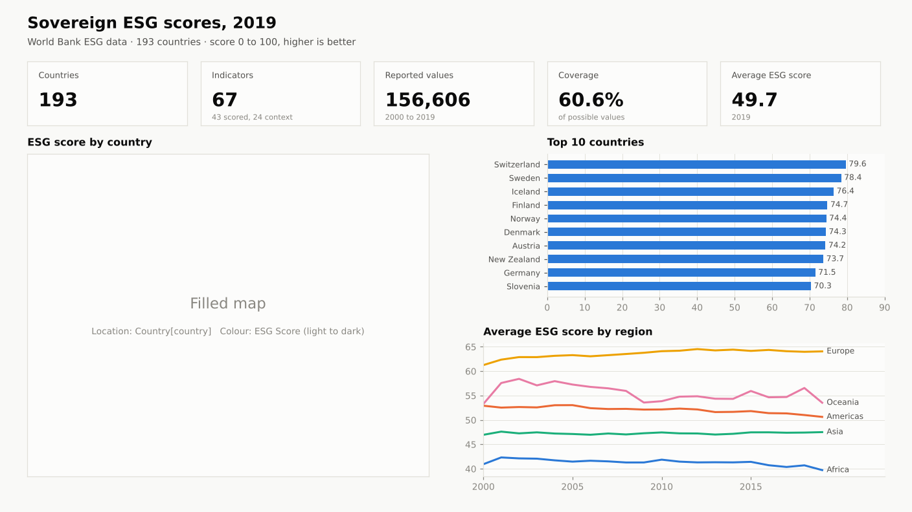
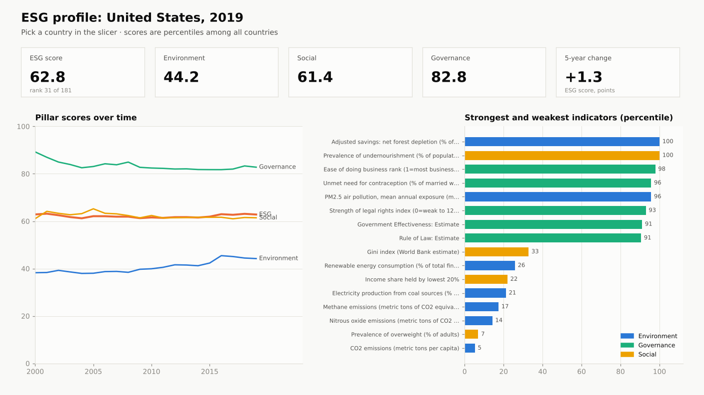
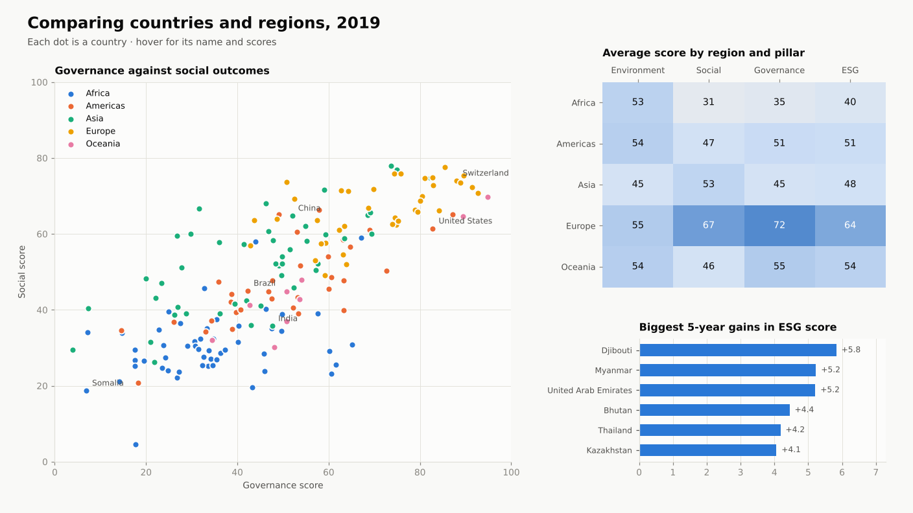
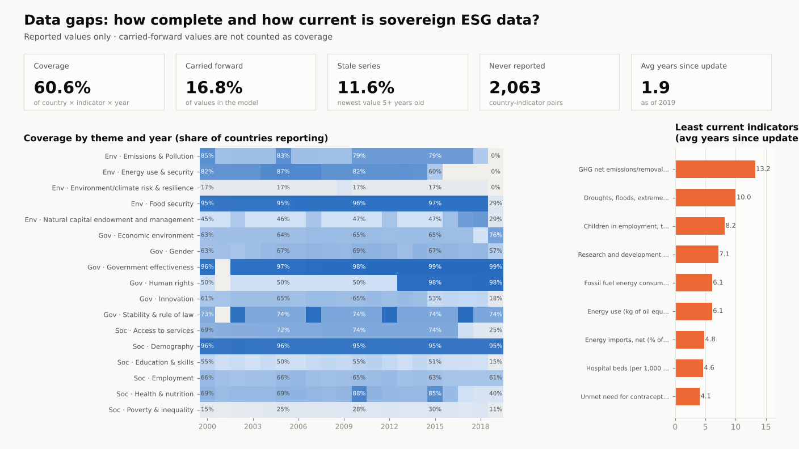

# Sovereign ESG Tracker (Power BI)

> **Status:** the data model, measures, theme and a generated Power BI project (`powerbi/project/ESG Tracker.pbip`) are here. The project has been validated against Microsoft's file schemas but has not yet been opened in Power BI Desktop, and the pictures below are mockups drawn from the same data. Once the report is opened, checked and saved as `esg_tracker.pbix`, replace the mockups with screenshots and delete this note. See [`powerbi/BUILD_GUIDE.md`](powerbi/BUILD_GUIDE.md).

A four-page Power BI report on the World Bank's sovereign ESG data: 67 environmental, social and governance indicators for 193 countries from 2000 to 2019, 156,606 reported values.

It answers two questions:

1. **How do countries compare?** Each indicator is turned into a 0 to 100 percentile score, pointed so that higher is always better, and rolled up into Environment, Social, Governance and overall ESG scores.
2. **How good is the data behind those scores?** A full page tracks what is reported, by whom, and how old it is, because an ESG score is only as current as its inputs.



## What the data shows

- **Governance and social outcomes move together; environment does not.** Across countries in 2019, governance and social scores correlate at 0.76. Environment correlates with governance at 0.10 and with social at −0.16. Countries that score well on institutions and living standards tend to emit more per person.
- **Regional gaps are wide and stable.** Europe averages 64.1 and Africa 39.7 on the overall score in 2019, and the ordering of regions has not changed in twenty years.
- **A country can be strong and weak at once.** The United States ranks 31 of 181 overall: 82.8 on governance but 44.2 on environment, in the bottom 6% for CO2 emissions per person.
- **Four in ten possible values are missing.** Only 60.6% of country, indicator and year combinations have a reported value. Poverty and inequality indicators are reported for 24% of them.
- **The newest year is always thin.** Coverage is 61 to 67% for every year from 2002 to 2015, then falls to 35% for 2019, because many series take two or more years to be published. Energy indicators in this snapshot stop in 2015.
- **2,063 country-indicator series have never been reported**, and 11.6% of the rest are five or more years out of date.





## What is in the repository

```
data/model/               six CSVs that Power BI loads (star schema)
prep/build_dataset.py     builds them from the raw World Bank file, in SQL (DuckDB)
prep/indicator_directions.csv   which way each indicator points, with the reason
prep/make_reference.py    writes expected_values.md and the mockups
powerbi/project/          generated Power BI project (PBIP): model, measures, four pages
powerbi/make_pbip.py      the script that generates it
powerbi/BUILD_GUIDE.md    how to open the project, and a manual build, page by page
powerbi/measures.dax      29 DAX measures
powerbi/theme.json        report theme
powerbi/expected_values.md  what every card should show, computed outside Power BI
mockups/                  target look of each page
tests/                    14 checks on the model tables and the generated project
```

## Data model

```
Country (193) ──┬──< Observations (188,122) >──┬── Indicator (67)
                ├──< Scores (14,554)            │
                └──< Latest (10,868) >──────────┘
Years (20) ─────┴──< Observations, Scores
```

| Table | Grain | Notes |
|---|---|---|
| `Observations` | country, indicator, year | value, percentile score, the year it was actually reported, carried-forward flag |
| `Scores` | country, year, pillar | Environment, Social, Governance and ESG scores with rank |
| `Latest` | country, indicator | newest reported value and how many years old it is |
| `Country` | country | UN region and sub-region |
| `Indicator` | indicator | pillar, World Bank theme, direction, whether it is scored |

## How the scores are built

The World Bank publishes the indicators, not a score. The scoring here is an illustration of a common approach, and every choice is visible in `prep/build_dataset.py`:

1. **Direction.** Each indicator is marked higher-is-better, lower-is-better or context. 43 are scored. 24 are context only (for example population density, or raw counts not scaled by country size) and are shown but never scored. The reason for each is in `prep/indicator_directions.csv`.
2. **Gaps.** A missing year takes the most recent reported value from the previous five years, and is flagged. 16.8% of values in the model are carried forward. They count towards scores but never towards coverage.
3. **Indicator score.** Percentile rank among all countries with a value that year, 0 to 100, flipped where lower is better. An indicator-year needs at least 30 countries.
4. **Pillar score.** Simple average of a country's indicator scores in the pillar, only if it has at least half of them.
5. **ESG score.** Simple average of the three pillars, only if all three exist.

## Rebuild the data

```bash
pip install -r requirements.txt
python prep/build_dataset.py      # downloads the raw files, writes data/model/
python prep/make_reference.py     # expected values and mockups
pytest
```

## Limits

- **Snapshot of July 2021.** Data runs to 2019. The method works unchanged on a newer World Bank file with the same columns.
- **Country level, not company level.** These are sovereign indicators. Company ESG ratings are commercial products and are not freely redistributable.
- **The scores are relative.** A percentile says where a country stands among others that year, not whether it improved in absolute terms.
- **Equal weights.** Every scored indicator counts the same within its pillar and every pillar the same overall. Other weightings give other rankings.
- **Scores track income.** Richer countries score higher on social and governance indicators almost by construction. This is a known issue with sovereign ESG scores and is not corrected here.
- **Direction is a judgment.** The 43 calls in `indicator_directions.csv` are mine and can be argued with.
- **Not yet run in Power BI.** The measures and the generated project were written without Power BI available to run them. `expected_values.md` exists so that each measure can be checked against an independent calculation.

## Data and license

World Bank, *Environment, Social and Governance Data* (Sovereign ESG Data Portal), snapshot of July 2021 as published in [worldbank/ESG_gaps_research](https://github.com/worldbank/ESG_gaps_research). Licensed CC BY 4.0. Regions are from the UN M49 classification via [datasets/country-codes](https://github.com/datasets/country-codes).

The code in this repository is MIT licensed. The scores are my own construction and are not World Bank scores.
